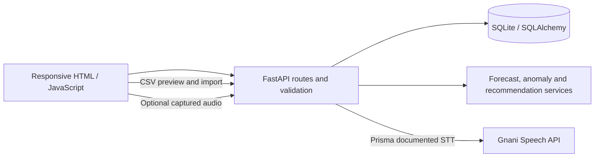
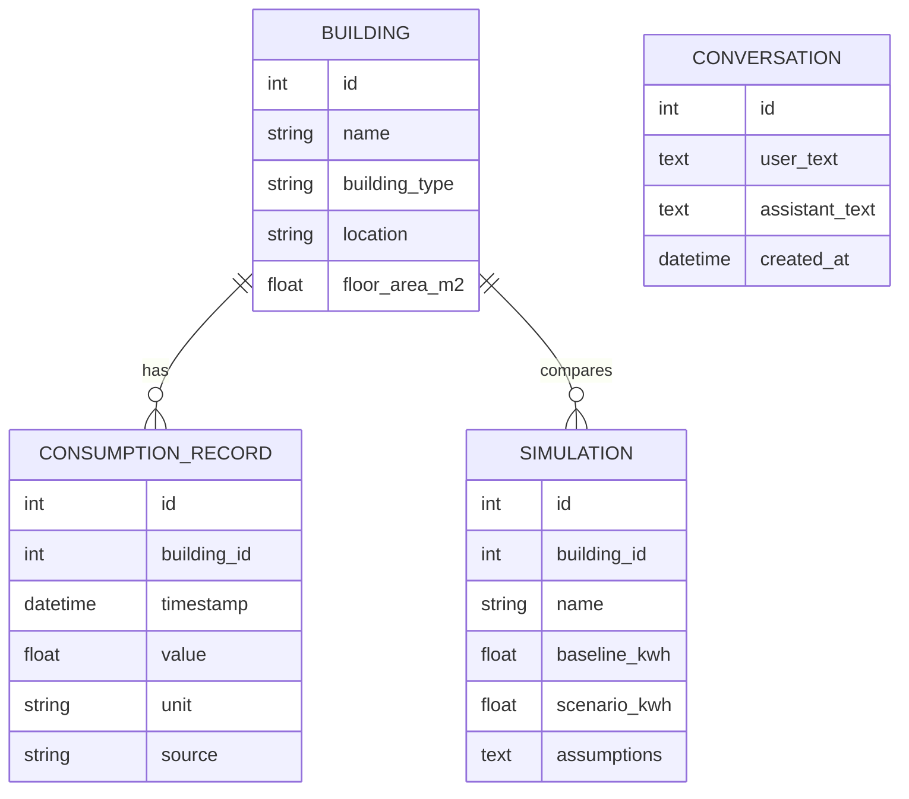

# EcoWatt

**An AI-powered energy forecasting and voice-based optimization platform** — *Forecast Today. Save Tomorrow.*

EcoWatt is a student-scale energy intelligence application for inspecting building meter readings. The workspace starts empty: every metric is either calculated from imported readings or clearly marked unavailable. There is no fabricated sample data.

## What works

- FastAPI backend, SQLite persistence, SQLAlchemy models and API docs at `/docs`.
- Building create, edit and delete; CSV preview and confirm-to-import flow; duplicate timestamp avoidance; unit validation; 10 MiB upload limit.
- Dashboard and daily analytics, user-entered tariff estimate, chronological Random Forest forecast and held-out MAE/RMSE/R², rolling median/MAD anomaly flags, evidence-linked recommendation, explicit what-if scenario persistence, assistant responses from backend data, and a generated PDF summary report.
- Responsive glass-style energy-campus dashboard with light/dark mode, latest reading, last 24-hour use, imported total, tariff-based cost, measured/forecast chart, alerts, quick report and CSV export actions.
- Deterministic assistant intents for consumption, daily totals, peak and hourly average, forecast, anomalies, tariff cost, recommendations, comparisons and explicitly hypothetical reduction scenarios. Short follow-ups use the previous question as context; answers remain grounded in the selected building's imported records.
- Voice workflow: choose English, Hindi, Hinglish or Punjabi, record up to 30 seconds, send audio to Prisma, show the transcript, answer from building analytics, then request Timbre speech playback. Text chat remains available without Gnani credentials. The browser never receives API keys.
- Server-side Gnani Prisma and Timbre clients. Language choices match documented Prisma v3 and Timbre v2.5 options, but live account/model behavior is not verified without credentials. Evon is deliberately not called until a verifiable official endpoint and payload contract are available.

## Run locally

Python 3.12 is preferred. This workspace only has Python 3.14.8; the application and tests were verified on that runtime.

```powershell
py -3.14 -m venv .venv
.venv\Scripts\Activate.ps1
python -m pip install -r requirements.txt
Copy-Item .env.example .env
uvicorn backend.main:app --reload
```

Open [http://127.0.0.1:8000](http://127.0.0.1:8000). The API docs are at `/docs`. The frontend is served by FastAPI, so no separate frontend server is needed. SQLite is created at `data/ecowatt.db`. In this workspace, the verified BDG2 sample was imported into the local database to make the dashboard immediately demonstrable; a fresh database starts empty and can import the same source through Buildings → Review sample.

Run checks with `pytest`. (Requires test dependencies from `requirements.txt`.)

Create a portable source bundle with `python scripts/package_release.py`. The generated `EcoWatt.zip` includes the app, requirements, documentation and attributed demo sample, and omits local environment secrets, virtual environments and SQLite state.

## Data source and limitations

The verified candidate dataset is [Building Data Genome Project 2](https://github.com/buds-lab/building-data-genome-project-2), an open dataset described by its maintainers as 3,053 meters across 1,636 non-residential buildings over 2016–2017 at hourly frequency. It contains electricity as well as heating/cooling water, steam, irrigation, and other meter types; use only electricity meters for this application's electricity workflow. The repository separates meter series under `data/meters/` and building metadata under `data/metadata/`. Values and units are source-specific; confirm the dataset's meter metadata before import. The GitHub repository lists CC BY-SA 4.0; retain attribution, license link, and indicate modifications when redistributing derived dataset material. See the [license text](https://github.com/buds-lab/building-data-genome-project-2/blob/master/LICENSE) and the original paper: Miller et al., *Scientific Data* 7, 368 (2020), DOI [10.1038/s41597-020-00712-x](https://doi.org/10.1038/s41597-020-00712-x).

The app bundles one 423 KB cleaned subset from that source: the `Panther_education_Teofila` electricity meter. It has 14,156 valid hourly readings from 2016-05-01 19:00 to 2017-12-31 23:00 and metadata identifies the space use as Education, floor area as 8,723.3 m² and timezone as `US/Eastern`. The source's electricity data has one timestamp column and one column per building-meter; hourly energy readings are in kWh summed over the hour. EcoWatt's included subset removes null readings, renames the selected meter column to `consumption_kwh`, and retains source timestamp/value values. Source cleaning removes outliers, long zero sequences and zero electricity values; it is not a full, unmodified raw series. Click **Review sample** in Buildings to preview and optionally import it. Attribution and adaptation detail is in `data/BDG2_ATTRIBUTION.md`. The dataset describes sites in North America and Europe; it is not representative of Indian institutional demand without local validation.

CSV import accepts one building and one selected timestamp/value pair per operation. Timestamps are parsed as UTC then stored without timezone metadata; this MVP should be extended to retain each building's source timezone before doing local-time schedules or peak-time comparisons. Select kWh or Wh only when source documentation supports it. kW is accepted as a unit label for storage, but forecasting and cost estimation are disabled because power readings cannot be converted into energy without a known interval. Mixed units for one building block analysis.

## ML and analytics

Forecasting uses calendar features, lag-1/lag-24 and rolling-24 average inputs, a chronological 80/20 holdout and a Random Forest model. MAE, RMSE and R² are reported from that held-out segment. The model fits only when enough points exist, has no weather/occupancy/end-use context, and its recursive short forecast is not a guarantee. This implementation currently assumes regular sampling when constructing lag features; irregular input should be resampled and audited before production use. Forecast endpoints cap horizon at 30 records.

Anomalies use a trailing rolling median and median absolute deviation with a minimum relative threshold. An anomaly is a statistical deviation, not a conclusion about wastage. The recommendation only identifies a recurring high-use hour and asks users to investigate schedules; it estimates no savings because end uses are not submetered. Scenarios uniformly apply the user's reduction percentage to the full building dataset; the result is an assumption exercise, not a measured intervention impact. Tariff is user entered; carbon estimates are not provided because no regional emissions factor has been configured.

## Gnani integration

Read the [Gnani Speech APIs introduction](https://docs.gnani.ai/api/introduction/introduction) and [Quick Start](https://docs.gnani.ai/api/introduction/quick-start). Current documented speech API uses `https://api.vachana.ai` with `X-API-Key-ID`. Prisma REST uses `POST /stt/v3` with multipart `audio_file`, a language code and optional model; supported STT audio includes WAV, MP3, OGG, FLAC, AAC and M4A, with a 30 second clip limit. Timbre's documented REST route is `POST /api/v1/tts/inference` and returns binary audio. The clients use those contracts. `GNANI_PRISMA_API_KEY` enables voice transcription and `GNANI_TIMBRE_API_KEY` enables audio playback of assistant replies. A service is marked Connected only after a successful authenticated request. An Evon key remains unsupported until its official endpoint contract is verified. No browser speech synthesis, other LLM or alternate provider is used.

Copy `.env.example` to `.env`, then set the appropriate keys only after receiving credentials. Restart the backend. `.env` is ignored by Git. Demo mode works without provider credentials using the clearly labeled, attributed BDG2 subset; microphone transcription requires Prisma, while speech playback requires Timbre.

## Architecture





ML workflow: CSV mapping and validation → chronological feature construction → chronological train/test → holdout metrics → refit → short recursive estimate. Voice workflow: microphone permission → selected-language, supported-format audio upload → Prisma transcription (when credentials exist) → transcript shown in chat → data-grounded answer → Timbre speech request and playback in the selected language (when credentials exist). Evon remains unavailable pending a verifiable API contract.

## API highlights

`/api/health`, `/api/buildings`, `/api/data/preview`, `/api/data/upload`, `/api/data/sample`, `/api/data/export`, `/api/dashboard/summary`, `/api/analytics`, `/api/forecast`, `/api/models/performance`, `/api/anomalies`, `/api/recommendations`, `/api/simulations`, `/api/assistant/chat`, `/api/assistant/voice`, `/api/assistant/speech`, `/api/assistant/status`, `/api/assistant/history`, `/api/reports`. FastAPI's interactive schema lists exact parameters and responses.

## Database and schema changes

The current MVP creates tables at startup via SQLAlchemy metadata. For a deployed app, add Alembic migrations before evolving a populated database. API keys are not stored in SQLite. Conversation history stores user prompts and answers locally; do not treat it as a production multi-user privacy design.

## Student demo walkthrough

1. Add a building and explain that building records are metadata, not energy readings.
2. Preview a source-documented electricity CSV; select its timestamp, consumption column and unit; confirm import.
3. Show that chart and summary values derive from imported records.
4. Explain chronological evaluation and MAE/RMSE/R²; discuss short forecast limits.
5. Inspect a rolling-baseline anomaly and why an anomaly is not proof of wastage.
6. Run a scenario and explain that the reduction is a user assumption, not a promised saving.
7. Ask the assistant a data-backed question; show that absent data or API credentials yield honest limitations.
8. Explain that Prisma's documented contract is implemented, while Evon is intentionally held until official endpoint details are available.

## Current scope and next steps

This is a working MVP foundation rather than every item in the original master prompt. It does not implement monthly forecasting, user authentication, cross-building normalization, multi-turn LLM reasoning, Evon, PDF scenario comparison charts, data-edit workflows, persisted Joblib model artifacts or formal DB migrations. Dataset licensing terms should be retained if redistributing records. Add integration testing with real Gnani credentials before claiming those external services have been verified.


## Immersive EcoWatt command-center interface

The overview now uses a full-width energy-campus scene, glassmorphism KPI panels, forecast and building signals, AI insight cards, a prominent animated Talk to EcoWatt action, a horizontal navigation bar, and a light/dark theme. The campus artwork is a visual background; all displayed energy values remain bound to imported meter data and the existing analytics API. The voice action opens the existing assistant workflow (Gnani credentials and browser microphone permission are still required for live voice services).

## Beginner-friendly interface update

The dashboard includes an optional first-steps guide on the Overview page. It walks a new user through adding a building, importing electricity readings, and exploring insights. Progress updates from the actual building and meter-record state and is retained locally. The guide can be collapsed or reopened at any time.

The building creation flow now uses a clear in-app form instead of browser prompt popups. The CSV import panel explains what a CSV file is, what columns are needed, and what each mapping field means before the user confirms the import. Forecast, model evaluation, and scenario pages use plain-language descriptions, and the voice assistant includes a short how-to guide. Advanced features and existing API behavior remain available.
